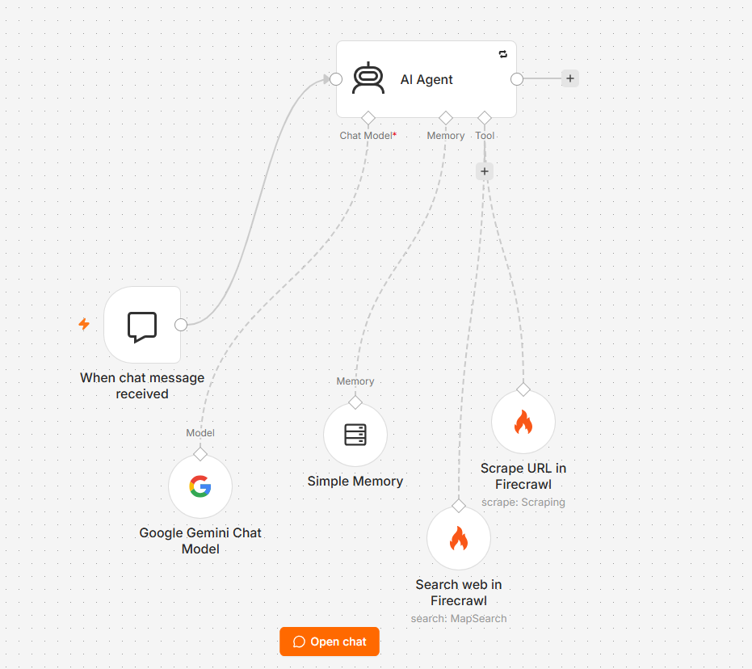
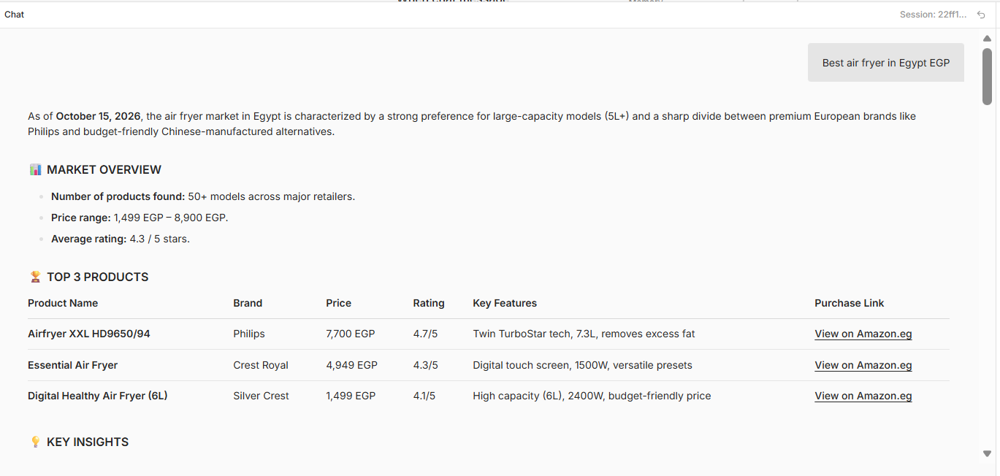

# 🛒 Product Research Agent (n8n + Gemini + Firecrawl)

An AI agent that researches any commercial product and generates a
market report: price range, top 3 comparison, common complaints,
and a buy/sell recommendation.

## How it works
1. User sends a product query in the n8n chat
2. Agent searches review/comparison articles via Firecrawl Search
3. Scrapes the top 2 results via Firecrawl Scrape
4. Gemini analyses the data and returns a structured report

## Tech stack
- n8n (workflow automation)
- Google Gemini Chat Model
- Firecrawl (search + scrape)
- Simple Memory (conversation context)

## Setup
1. Import `workflow.json` into n8n (Workflows → Import from file)
2. Add your credentials: Google Gemini API key, Firecrawl API key
3. Paste the prompt from `system-prompt.md` into the AI Agent's System Message
4. Open the chat and try: "best wireless earbuds under ₹2000"

## Example output

**Query:** `Best air fryer in Egypt EGP`

 
Click to view the full report

📊 **MARKET OVERVIEW**
-	**Number of products found: ** 50+ models across major retailers.
-	**Price range: ** 1,499 EGP – 8,900 EGP.
-	**Average rating: **4.3 / 5 stars.
### 🏆 TOP 3 PRODUCTS

| Product Name | Brand | Price | Rating | Key Features | Purchase Link |
|--------------|-------|-------|--------|--------------|---------------|
| Airfryer XXL HD9650/94 | Philips | 7,700 EGP | 4.7/5 | Twin TurboStar tech, 7.3L, removes excess fat | [View on Amazon.eg](PASTE_LINK_HERE) |
| Essential Air Fryer | Crest Royal | 4,949 EGP | 4.3/5 | Digital touch screen, 1500W, versatile presets | [View on Amazon.eg](PASTE_LINK_HERE) |
| Digital Healthy Air Fryer (6L) | Silver Crest | 1,499 EGP | 4.1/5 | High capacity (6L), 2400W, budget-friendly price | [View on Amazon.eg](PASTE_LINK_HERE) |

### 💡 KEY INSIGHTS
- **Capacity is King:** Egyptian consumers prioritize "XXL" or 6L+ models to accommodate large family meals and whole chickens.
- **Digital vs. Manual:** While manual dial models are the cheapest (starting at ~1,400 EGP), digital touch panels with presets (Chicken, Fries, Fish) are the top-selling category in 2026.
- **Brand Trust:** Philips remains the gold standard for "Rapid Air" technology, but brands like Black & Decker and Crest Royal are capturing the middle market due to aggressive pricing.

### ⚠️ COMMON COMPLAINTS
- **Non-Stick Peeling:** Several users report that the basket coating begins to flake after 6-8 months of heavy use, especially if cleaned with abrasive sponges.
- **Size Discrepancy:** Budget brands often market "6L" capacity, but users find the actual usable basket space smaller than premium 4L models.
- **Power Cord Length:** Recurring complaints about short power cables requiring kitchen reconfiguration or extensions.

### ✅ RECOMMENDATION
- **Best product to BUY:** Philips XXL HD9650/94. Despite the higher price (7,700 EGP), its "Twin TurboStar" technology and superior build quality offer the best long-term value and healthiest results by actively removing fat.
- **Best niche opportunity to SELL:** Mid-range 8L-10L "Dual Basket" fryers. There is a visible market gap for dual-basket fryers in Egypt priced between 3,500 and 5,000 EGP. Most current options are either very cheap single-basket units or ultra-premium Philips models.

---
*Note: Prices and availability are based on data from Amazon.eg and Alcoupon reviews as of October 15, 2026. Local VAT is generally included in these prices.*

## Limitations
- Depends on the quality of the review pages found
- Prices can be outdated, so check the source links

